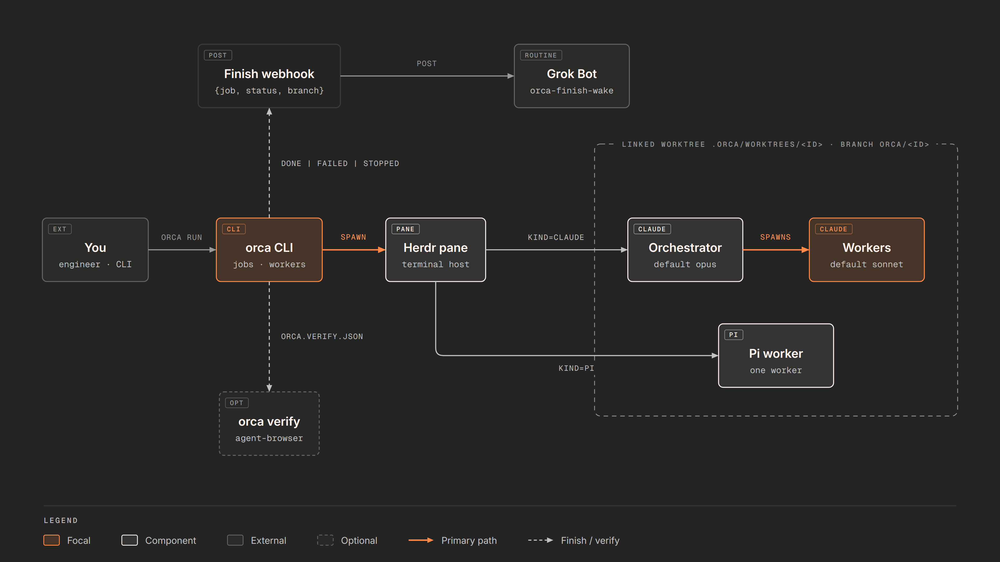
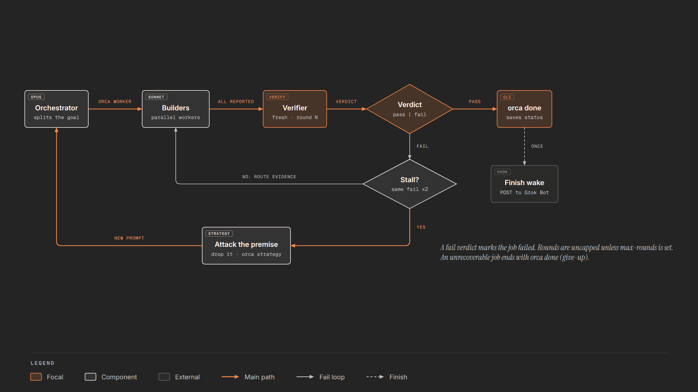
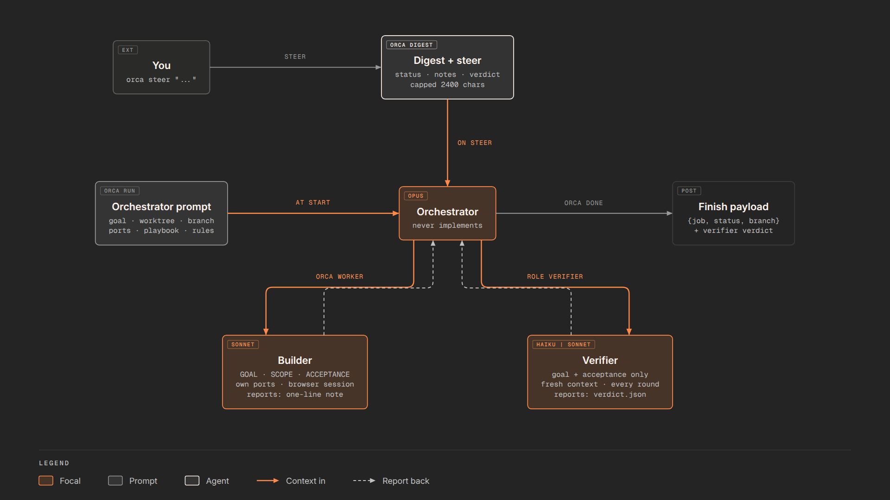

# orka

Local jobs for one git repo. `orka init` marks the repo. `orka run` checks out a linked worktree and starts an agent there, in a Herdr pane. You decide what to merge.

Not a fork of [limen](https://github.com/overment/limen). Not the old `orch` script. Fresh Node ESM, zero dependencies, local git only. Details live in [docs/](docs/README.md). Backlog: [tasks/](tasks/).

Formerly **orca**. `orca` still works as a deprecated alias, and repos with an existing `.orca/` keep using it; see [rename.md](docs/rename.md).

## How orka works

**Orchestrator, workers, verifier.** `orka run` starts an orchestrator that splits the goal and starts one worker per task, in parallel when tasks are independent. After the builders report, it starts one verifier, in rounds. The verifier runs `orka verify`, the project's checks and targeted browser checks, and writes a pass/fail verdict. On fail the orchestrator routes each blocking failure back to the builder that owns it. If the same check fails two rounds in a row, orka flags a stall and the orchestrator must change strategy (`orka strategy`) instead of repeating itself. Only the orchestrator runs `orka done`. See [verifier.md](docs/verifier.md), [verify.md](docs/verify.md).

**Panes and Herdr.** Each job gets a Herdr workspace; workers and the verifier are split panes in it. orka frees finished worker panes and browsers on `done`/`stop` and reaps a worker's browsers mid-job (`orka reap`). The orchestrator pane stays open for feedback until `orka cleanup` closes stale workspaces. See [cleanup.md](docs/cleanup.md), [ports.md](docs/ports.md).

**Worktrees.** Each job runs on branch `orka/<id>` in a linked worktree under `.orka/worktrees/<id>`. All workers share that checkout, so keep their tasks off the same files. Nothing is merged for you: look at the branch, then merge it yourself. See [layout.md](docs/layout.md).

**Watcher and webhook.** `orka run` starts a needs-input watcher that POSTs when the orchestrator is blocked or idle on a question. When the CLI marks a job `done`, `failed` or `stopped`, it POSTs the finish wake once. Both are off unless `.orka/secrets/finish-webhook.env` exists. See [needs-input.md](docs/needs-input.md), [webhooks.md](docs/webhooks.md), [follow-up.md](docs/follow-up.md).

**Context injection.** Each agent gets its context at a fixed point: the orchestrator prompt at `run`, a worker or verifier prompt at `orka worker`, a capped digest plus your message on `steer`, notes and results files when a worker reports, and the finish payload at the end.

Diagram sources: [diagrams.md](docs/diagrams.md).

## What you can use

Commands (full flags in [commands.md](docs/commands.md)):

| Command | What it does |
| --- | --- |
| `orka init` | mark the repo, gitignore `.orka/` |
| `orka new` | file a job (title, goal) |
| `orka spec init <feature>` | scaffold `specs/<feature>/spec.md` ([specs.md](docs/specs.md)) |
| `orka run <id>` | worktree, pane, orchestrator, watcher |
| `orka worker` | start a builder or verifier worker; a verifier round runs the static gates first ([gates.md](docs/gates.md)) |
| `orka status` / `digest` | show a job, free memory, live panes, worker queue / capped snapshot |
| `orka steer <id> "msg"` | message the lead; follow-up round on a finished job |
| `orka propose <id>` | orchestrator: pause at the direction gate, notify ([gate.md](docs/gate.md)) |
| `orka approve <id>` | resume a job waiting at the direction gate |
| `orka stop` / `done` | end a job; send the finish wake |
| `orka strategy` / `log` | record a strategy change / a decision |
| `orka verify <id>` | browser checks in the worktree |
| `orka reap` / `cleanup` | free browsers / sweep finished jobs: browsers, done worktrees, stale workspaces (also runs at `new` and `run`) |
| `orka webhook <id>` | preview or retry the finish POST |
| `orka watch <id>` | needs-input watcher (started by `run`) |
| `orka autonomy [set <L0-L3>]` | per-repo level, CLI-enforced ([autonomy.md](docs/autonomy.md)) |
| `orka push <id> [--pr]` | push the job branch, open a PR (L2) |
| `orka land <id> [--push]` | merge into main, test, push (L3) |
| `orka chain` | run the task queue one job at a time, land per level |
| `orka watch <id>` | needs-input watcher and context handoff (started by `run`) |
| `orka handoff <id> [<worker>\|orchestrator]` | one context-handoff pass; `--dry-run` shows each pane's %, window and its source; a name hands that pane off now |

Key flags:

| Flag | Meaning |
| --- | --- |
| `--kind claude\|pi` | agent kind (default `claude`) |
| `--*-model <alias>` | orchestrator, worker or verifier model |
| `--max-rounds N` | opt-in ceiling on verifier rounds |
| `--spec <path>` | build the job from a committed spec |
| `--ui`, `--playbook` | UI job; feature, bug-fix, investigation, hillclimb |
| `--no-gate` | skip the direction gate (on for new features) |
| `--keep` | skip cleanup for this job |
| `--dry-run` | print the plan, change nothing |
| `--cwd <repo>` | run from outside the repo |

Roles:

| Role | Does |
| --- | --- |
| builder | implements one task in the shared worktree |
| verifier | checks the result, never edits product code |

Models (details in [models.md](docs/models.md)):

| Role | Default |
| --- | --- |
| orchestrator | `opus` |
| worker | `sonnet` |
| verifier | `haiku` (CLI job), `sonnet` (UI job) |
| Pi job | `pi` for all roles, no model flags |

Webhooks (details in [webhooks.md](docs/webhooks.md)):

| Webhook | When |
| --- | --- |
| finish wake | job `done`, `failed` or `stopped` |
| needs-input | orchestrator blocked or idle on a question |
| `orka webhook <id>` | retry or preview; `--force` re-sends |
| env | `WEBHOOK_URL`, `WEBHOOK_KEY` in `.orka/secrets/finish-webhook.env` |

Config:

| File | Purpose |
| --- | --- |
| `.orka/config.json` | local mark; `verify`, `verifierModel`, `staleAfter` |
| `~/.config/orka/config.json` | autonomy level per repo path (default L1) |
| `.orka/config.json` | local mark; `verify`, `verifierModel`, `staleAfter`, `memoryGuard` |
| `node_modules` in a job worktree | symlink to the main checkout's; real install when the lockfile differs |
| `.orka/config.json` | local mark; `verify`, `verifierModel`, `staleAfter`, `handoff` |
| `handoff` | `{"threshold": 0.5, "orchestrator": true, "maxHandoffs": 3, "busyPollMs": 5000, "contextWindow": N}` or `false`; builders and the orchestrator past the threshold of their detected window write a note with the handoff skill and hand off to a fresh pane ([handoff.md](docs/handoff.md)) |
| `orka.verify.json` | browser checks at the worktree root; commit it |
| ports | 4 per job: `ORKA_PORT`, `ORKA_PORTS` |

More: [comparisons.md](docs/comparisons.md) (limen, old orch, v0 skips).
