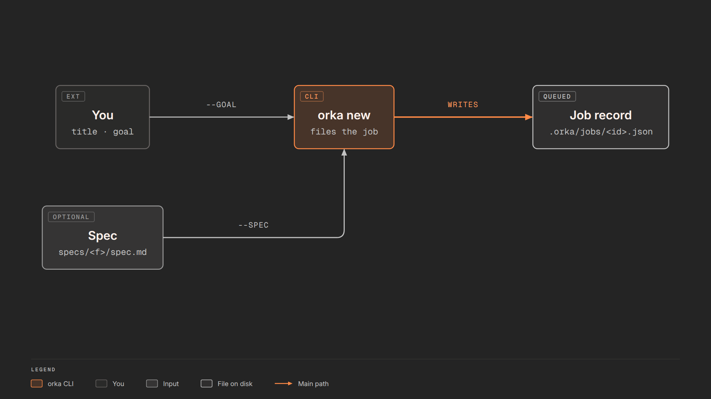
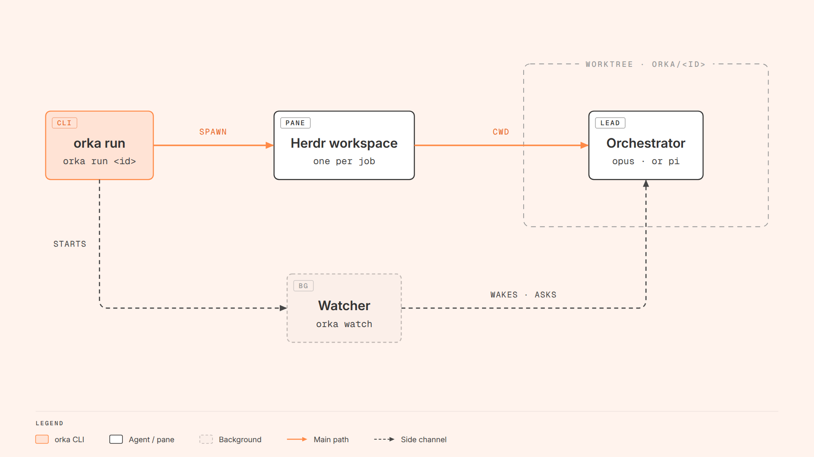
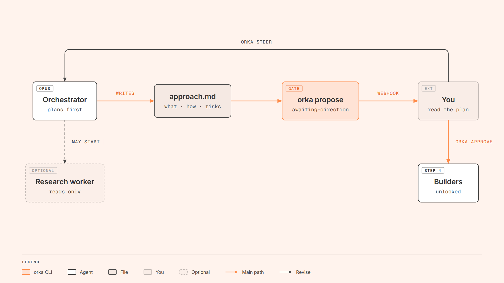
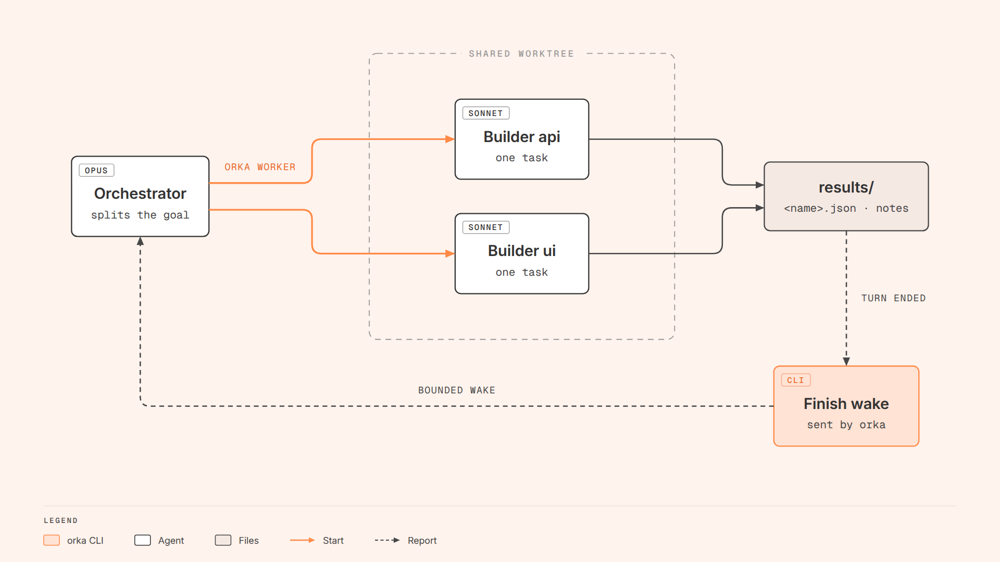
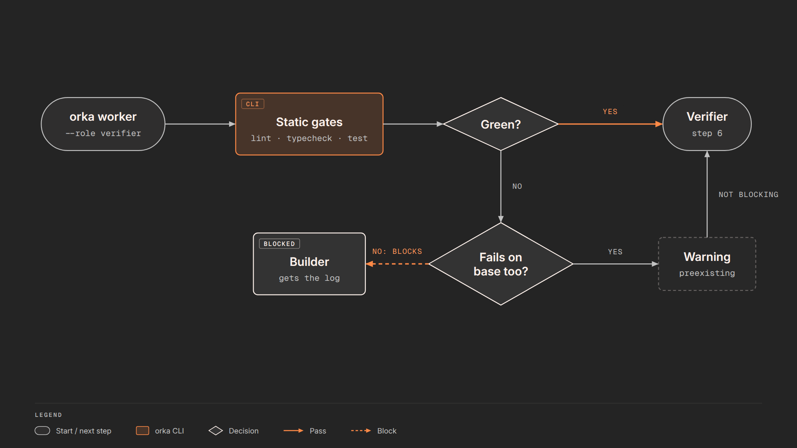
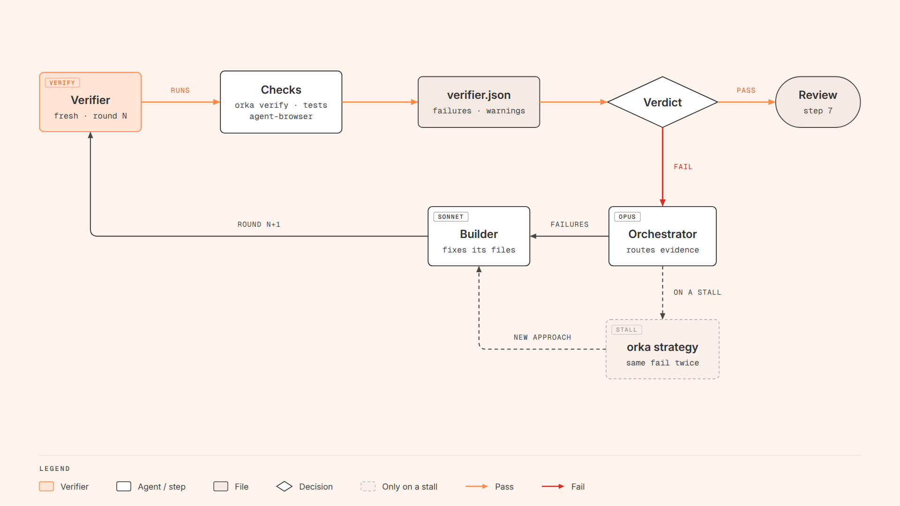
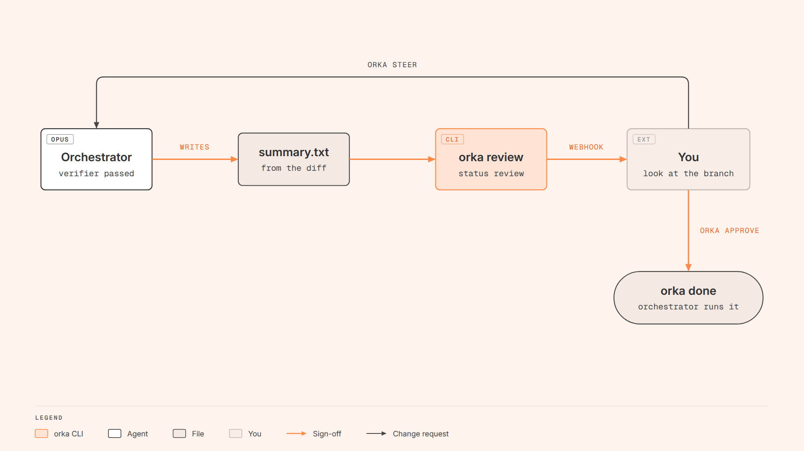
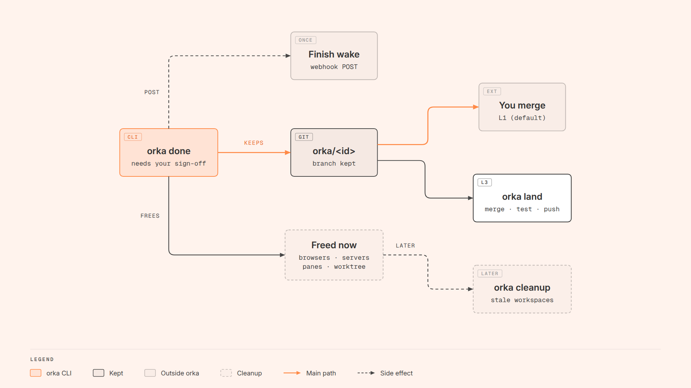

# Orka


Orka runs agent jobs in one git repo. You file a task. `orka run` checks out a linked worktree on its own branch and starts an orchestrator agent in a herdr-core terminal, which the Herdr desktop app shows. The orchestrator splits the work across builder agents, and a fresh verifier checks the result. The CLI enforces the rules: who may start, when a check blocks, and when a job is done. By default nothing is marked done or merged without your sign-off. Node ESM, zero dependencies.

## Install

Needs Node 22+, git, herdr-core (`hc`, with `herdr-core serve` running) and Claude Code (or Pi 1.1.0+). `agent-browser` is optional and needed only for browser checks. The old herdr TUI is deprecated: `ORKA_BACKEND=herdr` still uses it ([backends.md](docs/backends.md)).

```bash
git clone https://github.com/olafsulich/orka.git && cd orka
npm run install-bin                           # or: bash scripts/install.sh [dir]; links orka + orca alias into ~/bin
orka doctor                                   # lists anything missing, with the fix
```

## Quickstart

```bash
cd ~/projects/my-app
claude                     # once per repo: answer "Yes, I trust this folder", then /exit
orka init                  # marks the repo, gitignores .orka/
id=$(orka new --title "Fix footer year" --goal "The footer shows 2025; show the current year. Done when npm test passes.")
orka run "$id"             # worktree, branch orka/<id>, orchestrator pane
orka status "$id"          # any time
orka approve "$id"         # when it asks for your sign-off
git merge "orka/$id"       # orka never merges for you (unless the repo is at L3)
```

A title that starts with "Fix" skips the direction gate (step 3). A new feature stops there first, so you can approve the plan.

## How it works

### 1. File the task



`orka new` writes a job record under `.orka/jobs/` with status `queued`. The task comes from `--title` and `--goal`, or from a committed spec (`orka spec init`, then `orka new --spec`). Flags choose the agent kind, the models, the playbook, and whether the gate runs.
Docs: [commands.md](docs/commands.md), [specs.md](docs/specs.md), [models.md](docs/models.md).

### 2. Start the orchestrator



`orka run <id>` creates the branch `orka/<id>` in a linked worktree under `.orka/worktrees/<id>`. It starts the orchestrator in a herdr-core terminal (default `opus`), with each worker as its child, so the job shows up in the Herdr app. It also starts a watcher, which delivers wakes, pings you when the orchestrator is stuck on a question, and hands a pane off to a fresh agent when its context fills up.
Docs: [layout.md](docs/layout.md), [needs-input.md](docs/needs-input.md), [handoff.md](docs/handoff.md), [ports.md](docs/ports.md).

### 3. Agree on the approach



For a new feature, the orchestrator plans before anything is built. It may start read-only research workers. Then it writes `approach.md` and runs `orka propose`, which sends you a webhook. `orka worker` refuses builders until you run `orka approve <id>`. `orka steer <id> "..."` sends the plan back for revision. Fixes, the other playbooks (bug-fix, investigation, hillclimb) and `--no-gate` skip this step.
Docs: [gate.md](docs/gate.md).

### 4. Builders work in parallel



The orchestrator starts one builder per task with `orka worker` (default `sonnet`). All builders share the job's worktree, so their tasks must stay off each other's files. A builder only writes `results/<name>.json` and a note. When its turn ends, orka (not the agent) wakes the orchestrator with a bounded summary. `orka steer --to <worker>` reaches a builder between its tool calls.
Docs: [workers.md](docs/workers.md), [handoff.md](docs/handoff.md).

### 5. Static gates



Before each verifier round, `orka worker --role verifier` runs the repo's cheap checks itself: lint, typecheck, check and test, or the list in `.orka/config.json`. If a gate fails, orka reruns it on the base commit. A gate that fails there too is a pre-existing warning. A gate that fails only on the branch blocks: no verifier starts, and the log goes back to the builder.
Docs: [gates.md](docs/gates.md).

### 6. Verifier rounds



One verifier starts with a fresh context. It runs `orka verify`, the project's checks and targeted `agent-browser` checks, and writes a verdict. It never edits product code. On `fail`, the orchestrator routes each blocking failure, with its evidence, to the builder that owns it, then starts the next round. If the same check fails two rounds in a row, that is a stall, and the orchestrator must change strategy (`orka strategy`).
Docs: [verifier.md](docs/verifier.md), [verify.md](docs/verify.md), [doctor.md](docs/doctor.md).

### 7. Review and sign-off



A pass does not finish the job. The orchestrator writes `summary.txt` from the diff and runs `orka review`, which sends you a webhook. Look at the branch. `orka approve <id>` signs off, and the orchestrator runs `orka done`. `orka steer <id> "..."` asks for changes, and the job goes back through the workers and the verifier.
Docs: [review.md](docs/review.md), [follow-up.md](docs/follow-up.md).

### 8. Done, cleanup and merge



`orka done` refuses without your sign-off. With it, `orka done` sends the finish wake once and closes this job's browsers, dev servers and worker panes. It removes the worktree and keeps the branch. At the default level (L1) you merge `orka/<id>` yourself. At L2 `orka push --pr` opens a PR, and at L3 `orka land` merges, tests and pushes. The orchestrator pane stays open for follow-ups until `orka cleanup` closes stale workspaces.
Docs: [cleanup.md](docs/cleanup.md), [webhooks.md](docs/webhooks.md), [autonomy.md](docs/autonomy.md).

## Commands and config

| Command | What it does |
| --- | --- |
| `orka init` | mark the repo, gitignore `.orka/` |
| `orka new` / `spec init` | file a job / scaffold a committed spec |
| `orka run <id>` | worktree, pane, orchestrator, watcher |
| `orka worker` | start a builder, or a verifier round (gates first) |
| `orka status` / `digest` | show a job / a capped snapshot |
| `orka steer <id> [--to <worker>] "msg"` | message the orchestrator or a worker; a follow-up round on a finished job |
| `orka propose` / `review` | orchestrator: wait for your direction / your sign-off |
| `orka approve <id>` | approve the plan, or sign off the result |
| `orka done` / `stop` | end a job (`done` needs your sign-off, or `--give-up`) |
| `orka resume <id>` | reattach the orchestrator of a job whose pane is gone |
| `orka strategy` / `log` | record a strategy change / a decision |
| `orka verify <id>` | browser checks from `orka.verify.json` |
| `orka reap` / `cleanup` | free a worker's browsers / sweep finished jobs |
| `orka doctor` | environment check, with a fix per problem |
| `orka autonomy`, `push`, `land`, `chain` | per-repo level L0-L3, push and PR, merge into main, run a queue |
| `orka watch` / `handoff` / `webhook` | watcher (started by `run`), context handoff, finish POST |

| Config | Purpose |
| --- | --- |
| `.orka/config.json` | per repo: `gates`, `verify`, `verifierModel`, `staleAfter`, `memoryGuard`, `handoff` |
| `~/.config/orka/config.json` | autonomy level per repo (default L1) |
| `.orka/secrets/finish-webhook.env` | `WEBHOOK_URL`, `WEBHOOK_KEY`; the default for jobs with no wake; no file, no webhooks |
| `~/.config/<bot>-finish-wake.env` | same keys; one job's webhooks with `orka new --wake <bot>`, `--wake-file <path>` or `ORKA_WAKE` ([webhooks.md](docs/webhooks.md)) |
| `orka.verify.json` | browser checks at the worktree root; commit it |

Every flag: [commands.md](docs/commands.md). All docs: [docs/](docs/README.md). Diagram sources: [diagrams.md](docs/diagrams.md).

---

Inspired by [limen](https://github.com/overment/limen) and [pstack](https://github.com/cursor/plugins/tree/main/pstack).
