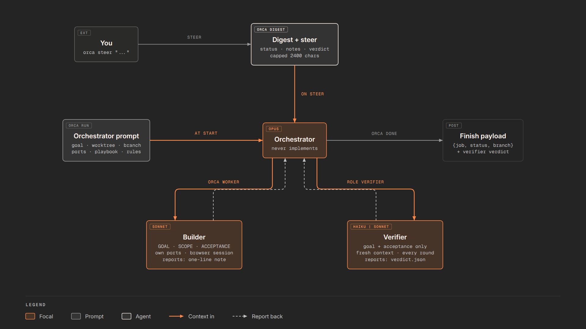
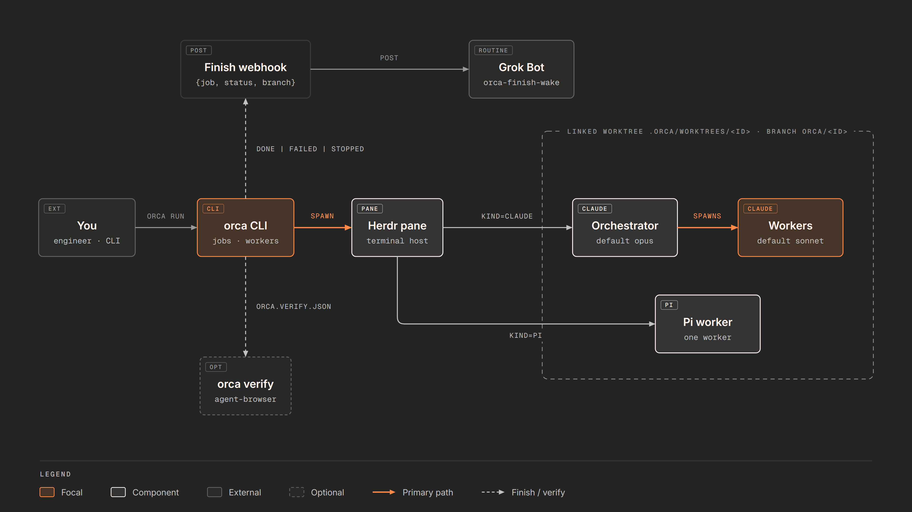
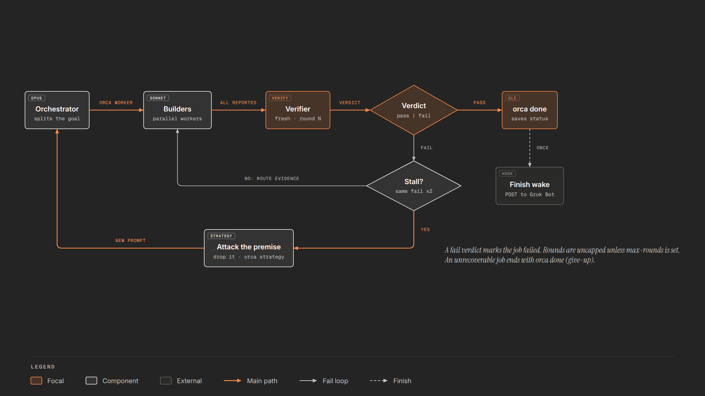

# Diagrams

The README explains orka in eight steps, one diagram each. They are made with diagram-framework (`~/projects/diagram-framework`): each is a clip, rendered as one still at its last frame. Sources and images live here, in `docs/img/readme/`.

| Step | Image | Source |
| --- | --- | --- |
| 1. File the task | [1-file.png](img/readme/1-file.png) | [src/1-file](img/readme/src/1-file/index.html) |
| 2. Start the orchestrator | [2-run.png](img/readme/2-run.png) | [src/2-run](img/readme/src/2-run/index.html) |
| 3. Agree on the approach | [3-gate.png](img/readme/3-gate.png) | [src/3-gate](img/readme/src/3-gate/index.html) |
| 4. Builders work in parallel | [4-workers.png](img/readme/4-workers.png) | [src/4-workers](img/readme/src/4-workers/index.html) |
| 5. Static gates | [5-gates.png](img/readme/5-gates.png) | [src/5-gates](img/readme/src/5-gates/index.html) |
| 6. Verifier rounds | [6-verifier.png](img/readme/6-verifier.png) | [src/6-verifier](img/readme/src/6-verifier/index.html) |
| 7. Review and sign-off | [7-review.png](img/readme/7-review.png) | [src/7-review](img/readme/src/7-review/index.html) |
| 8. Done, cleanup and merge | [8-done.png](img/readme/8-done.png) | [src/8-done](img/readme/src/8-done/index.html) |

## Re-render

```bash
node scripts/readme-diagrams.mjs             # all eight
node scripts/readme-diagrams.mjs 6-verifier  # one
```

The script copies each source into `<diagram-framework>/clips/orka-readme-<step>/`, runs `npm run stills -- <clip> --at <duration - 0.05>` there, and writes `docs/img/readme/<step>.png` (1920×1080, light skin). Then it removes the copy and its `out/` folder, so diagram-framework is left unchanged. It renders one step at a time, and each render starts and closes its own browser. Set `DIAGRAM_FRAMEWORK` if the framework is not at `~/projects/diagram-framework`.

The PNGs are generated, so never edit them by hand. Change the clip, re-render, and look at the PNG before you commit. The clips follow diagram-framework's `AGENTS.md` and `docs/grammar.md`: orthogonal connectors, labels of at most 14 characters, one or two focal nodes, and the legend at the bottom.

## Older diagrams

Stills of diagram-framework clips (`clips/orca-*`, commit `abb09c8`) from before the step diagrams. They still show the old name, orca. The README no longer uses them; they stay because the context-injection diagram has no step equivalent.

| Image | What it shows |
| --- | --- |
|  | What each agent receives and when: the orchestrator prompt, the worker and verifier prompts, the digest on `steer`, notes, and the finish payload. |
|  | `orka run` to a worktree and a Herdr pane, the orchestrator, workers, the verifier, and the finish wake. Replaced by steps 2, 4 and 6. |
|  | Orchestrator, workers, verifier rounds, the stall and strategy change, and `done` to the finish wake. Replaced by steps 4 to 8. |
